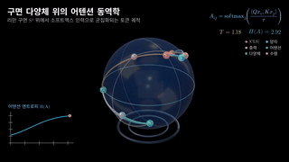
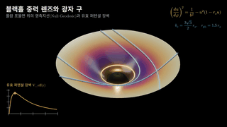
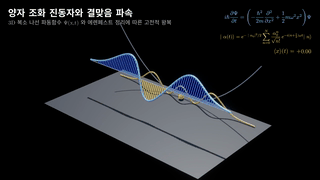
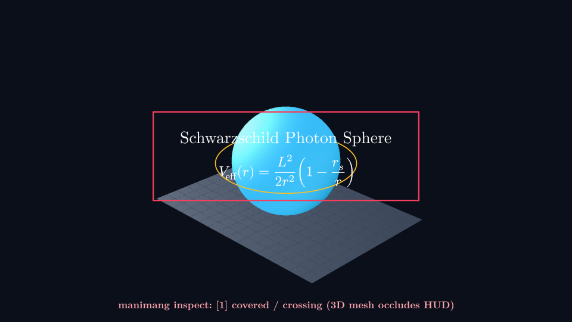
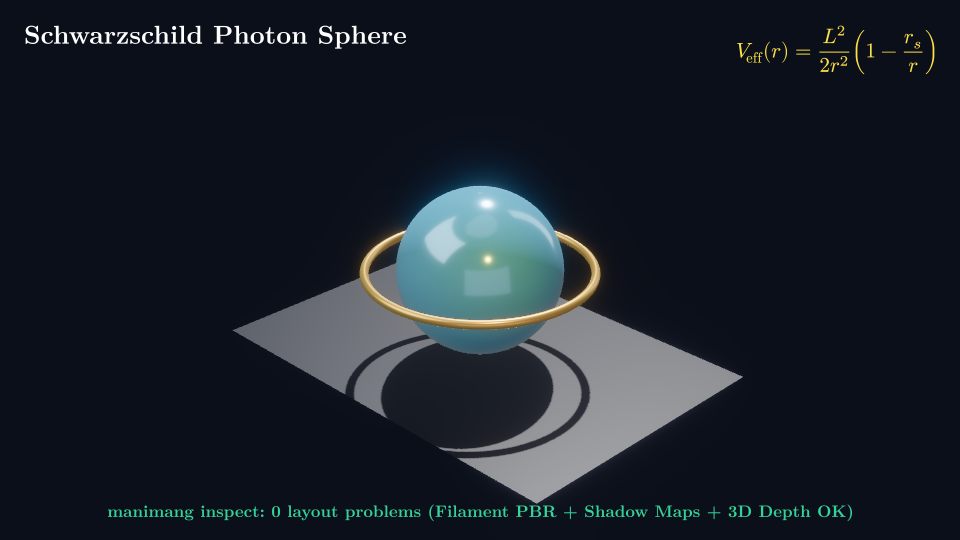

<p align="center">
  <a href="https://ainewground.com">
    <picture>
      <source media="(prefers-color-scheme: dark)" srcset="https://raw.githubusercontent.com/ainewground/ManimANG/main/docs/content/showcase/manimang-logo-dark.svg">
      <source media="(prefers-color-scheme: light)" srcset="https://raw.githubusercontent.com/ainewground/ManimANG/main/docs/content/showcase/manimang-logo-light.svg">
      
    </picture>
  </a>
</p>

<p align="center">
  🌐 <a href="https://github.com/ainewground/ManimANG/blob/main/README.md"><b>English</b></a> · <b>한국어 (Korean)</b>
</p>

<p align="center">
  <b><a href="https://ainewground.com">AI New Ground</a>가 만드는 에이전트 네이티브 3D 수학·과학 애니메이션 엔진, ManimANG.</b><br>
  Rust와 <code>wgpu</code> 기반 초고속 GPU 렌더링에 <b>3D 시공간 깊이·가림 검증(<code>manimang inspect</code>)</b>, <b>자율 자기교정 에이전트(<code>manimang agent</code>)</b>, <b>Google Filament 스튜디오 PBR 재질·실시간 그림자</b>, 그리고 <b>무료·로컬 한국어/다국어 음성 동기화(<code>Qwen3-TTS</code> 지피티쌤 보이스, <code>Edge</code>, <code>SystemVoice</code>)</b>를 결합했습니다.<br>
  <a href="https://github.com/academa-labs/manimgx">ManimGX</a>를 기반으로 확장되었으며 <a href="https://www.manim.community">Manim CE API</a>와 100% 호환됩니다.
</p>

<p align="center">
  <b><a href="https://ainewground.com">AI New Ground</a></b> ·
  <a href="https://github.com/ainewground/ManimANG/blob/main/README.ko.md#manimang-플래그십-3d-스튜디오-pbr-쇼케이스">3D PBR 쇼케이스</a> ·
  <a href="https://github.com/ainewground/ManimANG/blob/main/README.ko.md#왜-manimang인가">왜 ManimANG인가?</a> ·
  <a href="https://github.com/ainewground/ManimANG/blob/main/README.ko.md#동일-3d-장면-비교-기존-flat-3d-vs-manimang-스튜디오-pbr--3d-inspect">3D 질감·검증 비교</a> ·
  <a href="https://github.com/ainewground/ManimANG/blob/main/README.ko.md#시작하기-quickstart">빠른 시작</a> ·
  <a href="https://manimgx.academa.ai/reference/">API 레퍼런스</a>
</p>

<p align="center">
  <a href="https://github.com/ainewground/ManimANG"></a>
  <a href="https://github.com/ainewground/ManimANG/releases/tag/v0.1.1-showcase"></a>
  <a href="https://coverage.manimgx.academa.ai"></a>
  <a href="https://pypi.org/project/manimgx/"></a>
  <a href="https://www.npmjs.com/package/manimgx"></a>
</p>

## ManimANG 플래그십 3D 스튜디오 PBR 쇼케이스

**Google Filament 스튜디오 PBR 재질(`m.Material`)**, **실시간 그림자 맵(`m.SunLight(shadows=True)`)**, **스튜디오 소프트박스 환경광(`m.EnvironmentLight`)**, **AgX 필름 톤매핑**, **SSAO 접촉 그림자**, **3D 원통형 `tube()` 메쉬**, **`manimang inspect` 레이아웃 결함 0건 검증**, 그리고 **로컬 Apple Silicon MLX `Qwen3-TTS` 지피티쌤(`Aiden`) 내레이션**으로 렌더링한 **1080p60** 본편 쇼케이스입니다:

<p align="center">
  <a href="https://github.com/ainewground/ManimANG/blob/main/examples/attention_manifold.py"></a>
  <a href="https://github.com/ainewground/ManimANG/blob/main/examples/schwarzschild_geodesic.py"></a>
  <a href="https://github.com/ainewground/ManimANG/blob/main/examples/schrodinger_harmonic.py"></a>
</p>

| 플래그십 작품 및 1080p60 본편 영상 (음성 포함) | 수학·물리 방정식 모델 | 스튜디오 PBR 질감 및 화면 호흡 포인트 |
| :--- | :--- | :--- |
| **[`attention_manifold.py`](https://github.com/ainewground/ManimANG/blob/main/examples/attention_manifold.py)**<br>구면 다양체 위의 어텐션 동역학<br>[▶ 1080p60 전체 영상 보기 (지피티쌤 음성)](https://github.com/ainewground/ManimANG/releases/download/v0.1.1-showcase/film1_attention_manifold.mp4) · [자막(.srt)](https://github.com/ainewground/ManimANG/releases/download/v0.1.1-showcase/film1_attention_manifold.srt) | 단위 구면 $S^2$ 위의 연속 시간 트랜스포머 흐름:<br>$A_{ij} = \operatorname{softmax}_j(\langle Qx_i, Kx_j\rangle / \tau)$ | 반투명 유전체 유리 리만 구면(`Material(roughness=0.14)`), 8개 세라믹/금속 토큰 구체, 10개 3D 원통형 측지선 튜브, 좌하단 실시간 샤넌 엔트로피 $H(A)$ 곡선 연동 |
| **[`schwarzschild_geodesic.py`](https://github.com/ainewground/ManimANG/blob/main/examples/schwarzschild_geodesic.py)**<br>블랙홀 중력 렌즈와 광자 구<br>[▶ 1080p60 전체 영상 보기 (지피티쌤 음성)](https://github.com/ainewground/ManimANG/releases/download/v0.1.1-showcase/film2_schwarzschild_geodesic.mp4) · [자막(.srt)](https://github.com/ainewground/ManimANG/releases/download/v0.1.1-showcase/film2_schwarzschild_geodesic.srt) | 슈바르츠실트 플람 포물면 위의 영측지선(Null Geodesic):<br>$(du/d\varphi)^2 = 1/b^2 - u^2(1 - r_s u)$, $b_c = \frac{3\sqrt{3}}{2}r_s$ | 깊게 파인 3D 중력 우물 메쉬와 목 부분의 황금빛 `PointLight`, 3D 황금 토러스 광자 구($r_{\text{ph}} = 1.5\,r_s$), 7개 원통형 광선 튜브 + 실시간 유효 퍼텐셜 장벽 $V_{\text{eff}}(r)$ 그래프 |
| **[`schrodinger_harmonic.py`](https://github.com/ainewground/ManimANG/blob/main/examples/schrodinger_harmonic.py)**<br>양자 조화 진동자와 결맞음 파속<br>[▶ 1080p60 전체 영상 보기 (지피티쌤 음성)](https://github.com/ainewground/ManimANG/releases/download/v0.1.1-showcase/film3_schrodinger_harmonic.mp4) · [자막(.srt)](https://github.com/ainewground/ManimANG/releases/download/v0.1.1-showcase/film3_schrodinger_harmonic.srt) | 1차원 시간 의존 슈뢰딩거 방정식 결맞음 파속($N=12$ 에르미트-가우스 기저):<br>$\langle x \rangle(t) = \sqrt{2}\,\alpha_0 \cos(\omega t)$ | 스튜디오 바닥면 위에 **실시간 그림자(Shadow Map)**를 드리우는 3D 원통형 복소 나선 $\Psi(x,t) = (x, \operatorname{Re}\Psi, \operatorname{Im}\Psi)$, 바닥 확률 밀도 능선 $|\Psi|^2$ 및 위상 공간 $(\langle x\rangle, \langle p\rangle)$ 원 궤도 |

### 클래식 수학·물리 갤러리

<p align="center">
  <a href="https://github.com/academa-labs/manimgx/blob/main/examples/quadratic_formula.py"></a>
  <a href="https://github.com/academa-labs/manimgx/blob/main/examples/fourier_pi.py"></a>
  <a href="https://github.com/academa-labs/manimgx/blob/main/examples/linear_maps.py"></a>
  <br>
  <a href="https://github.com/academa-labs/manimgx/blob/main/examples/derivative.py"></a>
  <a href="https://github.com/academa-labs/manimgx/blob/main/examples/complex_maps.py"></a>
  <a href="https://github.com/academa-labs/manimgx/blob/main/examples/lorenz_attractor.py"></a>
  <br>
  <a href="https://github.com/academa-labs/manimgx/blob/main/examples/heavy_top.py"></a>
  <a href="https://github.com/academa-labs/manimgx/blob/main/examples/hopf_fibration.py"></a>
  <a href="https://github.com/academa-labs/manimgx/blob/main/examples/catenoid_helicoid.py"></a>
</p>

## 왜 ManimANG인가?

**ManimANG**(**A**I **N**ew **G**round / **A**gent-**N**ative **G**raphics)는 ManimGX의 초고속 Rust + `wgpu` 코어 위에 **3D 공간 레이아웃 검증, 자율 에이전트 교정 루프, 스튜디오 PBR 워크플로, 그리고 한국어·다국어 로컬/무료 음성 파이프라인**을 결합한 상위 호환(Superset) 엔진입니다:

| 핵심 역량 | ManimCE | ManimGL | ManimGX | **ManimANG (`ainewground/ManimANG`)** |
| :--- | :---: | :---: | :---: | :---: |
| **1080p60 5개 씬 렌더링 속도 (Apple M4 Pro)** | 278.83초 (1×) | 35.28초 (7.9×) | 3.08초 (90.6×) | **3.08초 (90.6×)** |
| **GPU 백엔드 및 스튜디오 PBR 셰이딩** | Cairo / ModernGL | OpenGL | Rust `wgpu` + Filament PBR | **Rust `wgpu` + Filament PBR + 3D 원통 튜브 워크플로** |
| **2D 레이아웃 자동 진단 (`inspect`)** | — | — | 2D 전용 (`Scene`) | **2D + 3D 통합 지원 (`ThreeDScene`)** |
| **3D 깊이·가림 진단 (`manimang inspect`)** | — | — | — | **4×4 카메라 투영 + 역방향 Z-깊이 버퍼 (`covered`, `crossing`, `small`, `cut`, `overlap`)** |
| **자율 자기교정 에이전트 (`manimang agent`)** | — | — | — | **`프롬프트 → 코드 → 3D Inspect → 자동 수정 → MP4` 폐루프** |
| **무료·로컬 한국어 및 다국어 TTS** | 외부 도구 필요 | 외부 도구 필요 | 유료 API (`FAL_KEY`) | **로컬 MLX `Qwen3-TTS`(지피티쌤 `Aiden`), 무료 `Edge`, 오프라인 `SystemVoice`** |
| **한국어 조사 분리 싱크 및 어절 보존 자막** | — | — | 띄어쓰기 단위만 지원 | **`[원]을` 음절 단위 조사 분리 싱크 + 어절 보존(`keep-all`) `.srt` 자막** |
| **브라우저 WebGPU + 동적 CJK 웹폰트** | — | — | 영문 기본 | **코드 내 한글·한자·가나 자동 감지 후 `manimgx-fonts-cjk` 동적 로드** |

## 동일 3D 장면 비교: 기존 Flat 3D vs ManimANG 스튜디오 PBR + 3D Inspect

AI 에이전트가 3D 깊이 검증이나 PBR 재질 없이 장면을 생성하면, 3차원 물체가 2차원 수식을 정면으로 가리거나(`covered`/`crossing`) 밋밋한 단색 음영으로 렌더링되기 쉽습니다. **`manimang inspect`**는 3D 메쉬와 2D 수식의 깊이 충돌을 자동으로 잡아내고, **ManimANG 스튜디오 PBR**은 Filament 물리 기반 재질, 소프트박스 반사광, AgX 톤매핑, 실시간 바닥 그림자 맵을 활성화합니다:

| 기존 Flat 3D (`shade_in_3d` + 3D 수식 가림 발생) | ManimANG 스튜디오 PBR + `manimang inspect` 검증 완료 (`0` 결함) |
| :---: | :---: |
|  |  |

## 벤치마크 속도 및 엔진별 품질 비교

**36.2초 분량의 1080p60 영상을 단 3.08초 만에 렌더링합니다.** Apple M4 Pro에서 5개의 벤치마크 씬을 처음부터 MP4 인코딩 완료까지 측정한 결과, ManimANG / ManimGX의 Rust + `wgpu` 엔진은 **ManimCE보다 90.6배**, **ManimGL보다 11.5배**, **Blender Workbench보다 18.7배 빠릅니다**. [측정 방법 및 전체 데이터](https://github.com/academa-labs/manimgx/tree/main/benchmarks)에서 모든 씬과 실행 로그를 확인할 수 있습니다.

<figure class="mx-benchmark">
  <picture>
    <source media="(prefers-color-scheme: dark)" srcset="https://manimgx.academa.ai/images/benchmark-dark.svg">
    <source media="(prefers-color-scheme: light)" srcset="https://manimgx.academa.ai/images/benchmark-light.svg">
    
  </picture>
  <p align="center"><sub>모든 엔진에서 가장 빠른 인코딩 프리셋을 사용했습니다. 낮을수록 빠릅니다.</sub></p>
</figure>

**동일 장면 엔진별 렌더링 비교 (`t = 2.5s`).** 8개의 연결된 3D 토러스 링을 각 엔진으로 렌더링한 결과입니다:

| ManimGX / ManimANG | ManimCE | ManimGL | Blender Workbench | Blender EEVEE |
| :---: | :---: | :---: | :---: | :---: |
|  |  |  |  |  |

## 시작하기 (Quickstart)

**pip / uv 설치.** macOS, Linux, Windows (Python 3.13 이상):

```sh
pip install manimgx
```

설치 즉시 `import manimang as m`과 `import manimgx as m`(그리고 `manimang`, `manimgx` CLI 명령어)을 모두 사용할 수 있으며, 한국어·다국어 폰트, Typst 수식 조판기, H.264 비디오 인코더가 모두 내장되어 있어 별도의 LaTeX이나 FFmpeg 설치가 필요 없습니다.

**AI 에이전트 프롬프트로 시작하기.** Claude Code, Codex, Antigravity, Cursor 등에 아래 프롬프트를 붙여넣으세요:

```text
Follow https://manimgx.academa.ai/llms.txt.
Install ManimANG, make a 3D animation of the solar system, and open it.
```

## 파이썬 코드에서 한국어 내레이션 3D 스튜디오 PBR 영상까지

아래 코드를 `korean_sphere.py`로 저장합니다:

```python
import manimang as m


class KoreanSphere3D(m.ThreeDScene):
    # 시그니처 지피티쌤 로컬 MLX Qwen3-TTS 보이스 (또는 m.Edge(), m.SystemVoice())
    voice = m.QwenTTS("Aiden", language="Korean", seed=20261017, speed=1.18)

    def construct(self) -> None:
        self.camera.tone_mapping = "agx"
        self.camera.ambient_occlusion = 1.0
        self.camera.bloom = 0.08
        self.set_camera_orientation(phi=65 * m.DEGREES, theta=-45 * m.DEGREES)
        self.add(
            m.EnvironmentLight(intensity=0.8),
            m.SunLight(4 * m.UP + 3 * m.LEFT + 5 * m.OUT, intensity=1.3, shadows=True),
        )
        sphere = (
            m.Sphere(radius=1.3, resolution=(48, 32))
            .set_color("#38bdf8")
            .set_material(m.Material(metallic=0.2, roughness=0.18, reflectance=0.8))
        )
        title = m.Text("구의 부피 공식", font_size=34, weight="BOLD").to_corner(m.UL)
        formula = m.MathTex(r"V = \frac{4}{3}\pi r^3", font_size=40).to_corner(m.UR)
        self.add_fixed_in_frame_mobjects(title, formula)
        self.say(
            "3차원 [구]의 부피 공식은 [다음과] 같습니다.",
            m.Create(sphere),
            m.Write(formula),
        )
```

3D 레이아웃 검증 후 `1080p60` MP4와 `.srt` 자막으로 렌더링합니다:

```sh
manimang inspect korean_sphere.py
manimang render korean_sphere.py
```

## 아키텍처 및 핵심 기술

- **완전한 정적 타입 지원.** 키워드 인자(`TypedDict`)와 `.animate` 체인까지 모두 타입이 지정되어 `ty`와 `ruff`로 실행 전 오류를 잡아냅니다.
- **2D와 3D의 완벽한 결합.** 물리 기반 3D 곡면, 원통형 튜브 메쉬, 실시간 그림자 맵, 카메라 궤도 회전과 2D 수식·실시간 그래프가 한 화면에서 자연스럽게 어우러집니다.
- **웹 브라우저 직접 실행.** `npm install manimgx`. [Pyodide](https://pyodide.org)가 Web Worker에서 파이썬을 실행하고 WebGPU가 렌더링하며, 한글·CJK 문자를 감지해 웹폰트를 동적으로 불러옵니다.
- **에이전트 피드백 루프.** `manimang inspect`가 스토리보드와 2D/3D 레이아웃 검사를 수행하고, `manimang agent`가 레이아웃 결함이 0건이 될 때까지 코드를 자율 교정합니다.
- **내장 LaTeX / Typst 수식 조판.** 무거운 TeX Live 설치 없이 Rust에 내장된 Typst + mitex가 수식을 즉시 벡터 곡선으로 조판합니다.
- **단어·음절 단위 음성 동기화.** `self.say()`가 `QwenTTS`, `Edge`, `SystemVoice`, `Fal` 음성의 단어/음절 타임스탬프에 맞춰 애니메이션을 정확히 실행합니다.

## 거인들의 어깨 위에서 (On the shoulders of giants)

**ManimANG**는 [Academa](https://academa.ai)의 [Abdullah Geduk](https://geduk.io)과 [Sina Atalay](https://sinaatalay.com)가 개발한 **[ManimGX](https://github.com/academa-labs/manimgx)**를 기반으로 **[AI New Ground](https://ainewground.com)**(`@gptssam`)가 개발하고 있습니다. [Grant Sanderson](https://www.3blue1brown.com)이 [Manim](https://github.com/3b1b/manim)을 창시했으며, ManimANG와 ManimGX는 [Manim Community Edition](https://www.manim.community)의 API를 따릅니다.

## 라이선스 (License)

ManimANG 및 ManimGX의 자체 코드는 [MIT 라이선스](https://github.com/ainewground/ManimANG/blob/main/LICENSE)로 배포됩니다.
x264가 포함된 네이티브 휠 배포판 전체는 GPL-3.0-or-later를 따르며, 서드파티 구성 요소의 라이선스는 [LICENSE-THIRD-PARTY](https://github.com/ainewground/ManimANG/blob/main/LICENSE-THIRD-PARTY)에 명시되어 있습니다.
