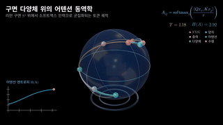
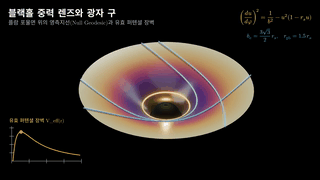
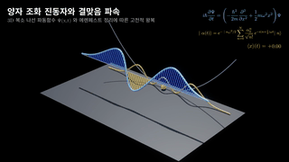
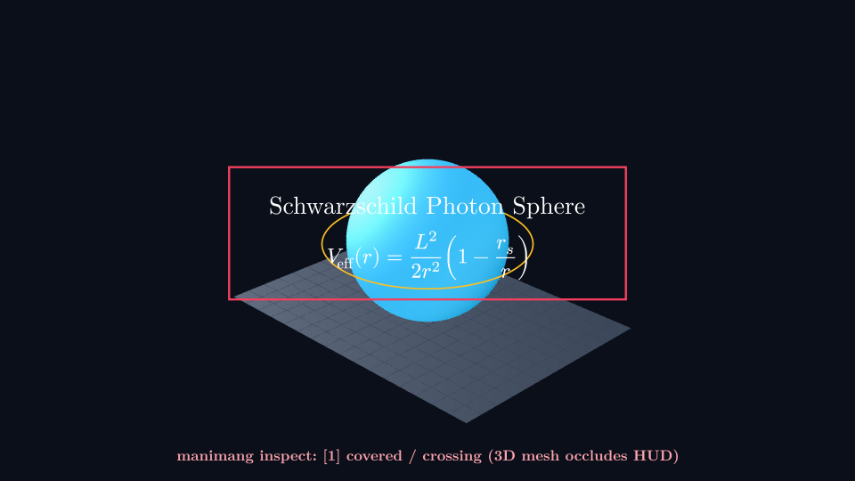
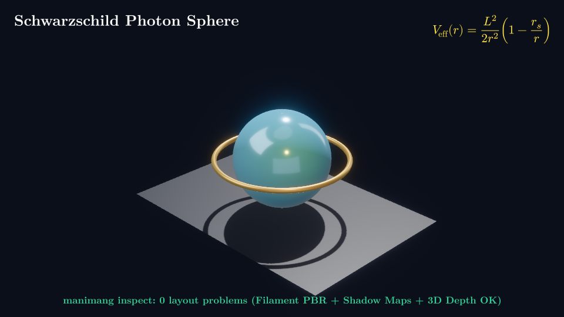

<p align="center">
  <a href="https://ainewground.com">
    <picture>
      <source media="(prefers-color-scheme: dark)" srcset="https://raw.githubusercontent.com/ainewground/ManimANG/main/docs/content/showcase/manimang-logo-dark.svg">
      <source media="(prefers-color-scheme: light)" srcset="https://raw.githubusercontent.com/ainewground/ManimANG/main/docs/content/showcase/manimang-logo-light.svg">
      
    </picture>
  </a>
</p>

<p align="center">
  🌐 <b>English</b> · <a href="https://github.com/ainewground/ManimANG/blob/main/README.ko.md"><b>한국어 (Korean)</b></a>
</p>

<p align="center">
  <b>Agent-Native 3D Mathematical &amp; Scientific Animation Engine by <a href="https://ainewground.com">AI New Ground</a>.</b><br>
  Powered by Rust and <code>wgpu</code> with 3D depth/occlusion diagnostics (<code>manimang inspect</code>), autonomous self-correction (<code>manimang agent</code>), Google Filament Studio PBR materials, and zero-key local/multilingual TTS (<code>Qwen3-TTS</code>, <code>Edge</code>, <code>SystemVoice</code>).<br>
  Built on <a href="https://github.com/academa-labs/manimgx">ManimGX</a> and 100% compatible with <a href="https://www.manim.community">Manim CE's API</a>.
</p>

<p align="center">
  <b><a href="https://ainewground.com">AI New Ground</a></b> ·
  <a href="https://github.com/ainewground/ManimANG#manimang-flagship-3d-pbr-showcases">Flagship 3D Showcases</a> ·
  <a href="https://github.com/ainewground/ManimANG#why-manimang">Why ManimANG?</a> ·
  <a href="https://github.com/ainewground/ManimANG#compare-3d-quality--layout-verification">3D PBR vs Legacy</a> ·
  <a href="https://github.com/ainewground/ManimANG#get-started">Quickstart</a> ·
  <a href="https://manimgx.academa.ai/reference/">API Reference</a>
</p>

<p align="center">
  <a href="https://github.com/ainewground/ManimANG"></a>
  <a href="https://github.com/ainewground/ManimANG/releases/tag/v0.1.1-showcase"></a>
  <a href="https://coverage.manimgx.academa.ai"></a>
  <a href="https://pypi.org/project/manimgx/"></a>
  <a href="https://www.npmjs.com/package/manimgx"></a>
</p>

## ManimANG Flagship 3D PBR Showcases

Rendered at **1080p60** with **Google Filament Studio PBR materials (`m.Material`)**, **real shadow maps (`m.SunLight(shadows=True)`)**, **image-based studio softbox lighting (`m.EnvironmentLight`)**, **AgX filmic tone mapping**, **SSAO contact shadows**, **3D cylindrical `tube()` meshes**, **0 layout defects verified by `manimang inspect`**, and **local Apple Silicon MLX `Qwen3-TTS` narration (`m.QwenTTS("Aiden")`)**:

<p align="center">
  <a href="https://github.com/ainewground/ManimANG/blob/main/examples/attention_manifold.py"></a>
  <a href="https://github.com/ainewground/ManimANG/blob/main/examples/schwarzschild_geodesic.py"></a>
  <a href="https://github.com/ainewground/ManimANG/blob/main/examples/schrodinger_harmonic.py"></a>
</p>

| Flagship Film &amp; Full 1080p60 Video | Mathematical &amp; Physical Model | ManimANG Studio PBR &amp; Choreography Highlights |
| :--- | :--- | :--- |
| **[`attention_manifold.py`](https://github.com/ainewground/ManimANG/blob/main/examples/attention_manifold.py)**<br>[▶ Watch Full 1080p60 MP4 (with Audio)](https://github.com/ainewground/ManimANG/releases/download/v0.1.1-showcase/film1_attention_manifold.mp4) · [.srt](https://github.com/ainewground/ManimANG/releases/download/v0.1.1-showcase/film1_attention_manifold.srt) | Riemannian continuous-time Transformer flow on $S^2$:<br>$A_{ij} = \operatorname{softmax}_j(\langle Qx_i, Kx_j\rangle / \tau)$ | Translucent dielectric glass Riemann sphere (`Material(roughness=0.14)`), 8 ceramic/metallic token orbs, 10 dynamic 3D cylindrical geodesic tubes, live 2D Shannon entropy curve $H(A)$ |
| **[`schwarzschild_geodesic.py`](https://github.com/ainewground/ManimANG/blob/main/examples/schwarzschild_geodesic.py)**<br>[▶ Watch Full 1080p60 MP4 (with Audio)](https://github.com/ainewground/ManimANG/releases/download/v0.1.1-showcase/film2_schwarzschild_geodesic.mp4) · [.srt](https://github.com/ainewground/ManimANG/releases/download/v0.1.1-showcase/film2_schwarzschild_geodesic.srt) | General-relativistic null geodesics on Flamm's paraboloid:<br>$(du/d\varphi)^2 = 1/b^2 - u^2(1 - r_s u)$, $b_c = \frac{3\sqrt{3}}{2}r_s$ | Deep gravitational funnel mesh with warm throat `PointLight`, golden 3D photon-sphere torus ($r_{\text{ph}} = 1.5\,r_s$), 7 tubular photon trajectories + live $V_{\text{eff}}(r)$ barrier plot |
| **[`schrodinger_harmonic.py`](https://github.com/ainewground/ManimANG/blob/main/examples/schrodinger_harmonic.py)**<br>[▶ Watch Full 1080p60 MP4 (with Audio)](https://github.com/ainewground/ManimANG/releases/download/v0.1.1-showcase/film3_schrodinger_harmonic.mp4) · [.srt](https://github.com/ainewground/ManimANG/releases/download/v0.1.1-showcase/film3_schrodinger_harmonic.srt) | 1D TDSE coherent wavepacket ($N=12$ Hermite-Gauss basis):<br>$\langle x \rangle(t) = \sqrt{2}\,\alpha_0 \cos(\omega t)$ | Gleaming 3D cylindrical complex corkscrew $\Psi(x,t) = (x, \operatorname{Re}\Psi, \operatorname{Im}\Psi)$ casting real shadows onto a studio floor beside the 3D probability ridge $|\Psi|^2$ and $(\langle x\rangle, \langle p\rangle)$ orbit |

### Classic Mathematical &amp; Physical Gallery

<p align="center">
  <a href="https://github.com/academa-labs/manimgx/blob/main/examples/quadratic_formula.py"></a>
  <a href="https://github.com/academa-labs/manimgx/blob/main/examples/fourier_pi.py"></a>
  <a href="https://github.com/academa-labs/manimgx/blob/main/examples/linear_maps.py"></a>
  <br>
  <a href="https://github.com/academa-labs/manimgx/blob/main/examples/derivative.py"></a>
  <a href="https://github.com/academa-labs/manimgx/blob/main/examples/complex_maps.py"></a>
  <a href="https://github.com/academa-labs/manimgx/blob/main/examples/lorenz_attractor.py"></a>
  <br>
  <a href="https://github.com/academa-labs/manimgx/blob/main/examples/heavy_top.py"></a>
  <a href="https://github.com/academa-labs/manimgx/blob/main/examples/hopf_fibration.py"></a>
  <a href="https://github.com/academa-labs/manimgx/blob/main/examples/catenoid_helicoid.py"></a>
</p>

## Why ManimANG?

**ManimANG** (**A**I **N**ew **G**round / **A**gent-**N**ative **G**raphics) extends ManimGX's Rust + `wgpu` engine into a complete, self-verifying production pipeline for AI video agents and multilingual STEM creators:

| Capability | ManimCE | ManimGL | ManimGX | **ManimANG (`ainewground/ManimANG`)** |
| :--- | :---: | :---: | :---: | :---: |
| **1080p60 5-Scene Render Speed (Apple M4 Pro)** | 278.83 s (1×) | 35.28 s (7.9×) | 3.08 s (90.6×) | **3.08 s (90.6×)** |
| **GPU Backend &amp; Filament Studio PBR** | Cairo / ModernGL | OpenGL | Rust `wgpu` + Filament PBR | **Rust `wgpu` + Filament PBR + 3D Tube Workflows** |
| **2D Layout Diagnostics (`inspect`)** | — | — | 2D only (`Scene`) | **2D + Full 3D (`ThreeDScene`)** |
| **3D Depth &amp; Occlusion Inspector (`manimang inspect`)** | — | — | — | **4×4 Projection + Reversed-Z Depth (`covered`, `crossing`, `small`, `cut`, `overlap`)** |
| **Closed-Loop Self-Correcting Agent (`manimang agent`)** | — | — | — | **Autonomous `Prompt → Code → 3D Inspect → Repair → MP4`** |
| **Free / Local Multilingual TTS** | External only | External only | Paid API (`FAL_KEY`) | **Local MLX `Qwen3-TTS` (`Aiden` / `Sohee`), Free `Edge`, Offline `SystemVoice`** |
| **CJK/Korean Syllable Span Sync &amp; `.srt` Captions** | — | — | Space-split only | **Syllable-level `[원]을` particle split + Eojeol-preserving (`keep-all`) `.srt`** |
| **Browser WebGPU + Dynamic CJK Font Loading** | — | — | Latin default | **Auto-detects Korean/CJK &amp; loads `manimgx-fonts-cjk` on demand** |

## Compare 3D Quality &amp; Layout Verification

When AI agents generate 3D scenes without depth-aware inspection or PBR materials, 3D geometry frequently collides with 2D equations and renders with flat legacy shading. **`manimang inspect`** catches 3D-vs-2D occlusions automatically, and **ManimANG Studio PBR** activates Filament materials, studio softbox reflections, AgX tone mapping, and real shadow maps:

| Legacy Flat 3D (`shade_in_3d` + Uninspected Occlusion) | ManimANG Studio PBR + `manimang inspect` Verified (`0` Defects) |
| :---: | :---: |
|  |  |

## Benchmark Speed &amp; Cross-Engine Comparison

**36.2 seconds of video, rendered in 3.08 seconds.** Across five scenes at 1080p60 on an Apple M4 Pro, the Rust + `wgpu` engine under ManimANG / ManimGX is **90.6× faster than ManimCE**, **11.5× faster than ManimGL**, and **18.7× faster than Blender Workbench**, from launch to finished MP4. [How it was measured](https://github.com/academa-labs/manimgx/tree/main/benchmarks): the scenes, the settings and every run.

<figure class="mx-benchmark">
  <picture>
    <source media="(prefers-color-scheme: dark)" srcset="https://manimgx.academa.ai/images/benchmark-dark.svg">
    <source media="(prefers-color-scheme: light)" srcset="https://manimgx.academa.ai/images/benchmark-light.svg">
    
  </picture>
  <p align="center"><sub>All engines use the fastest encoding preset available. Lower is better.</sub></p>
</figure>

**Compare the same scene.** Linked rings at 2.5 seconds, rendered by each engine:

| ManimGX | ManimCE | ManimGL | Blender Workbench | Blender EEVEE |
| :---: | :---: | :---: | :---: | :---: |
|  |  |  |  |  |

## Get started

**With pip / uv.** Install on macOS, Linux or Windows with Python 3.13+:

```sh
pip install manimgx
```

Both `import manimang as m` and `import manimgx as m` (as well as the `manimang` and `manimgx` CLIs) are available out of the box. Fonts, Typst math typesetting, and H.264 video encoding are bundled.

**With a prompt.** Paste into Claude Code, Codex, Antigravity, or Cursor:

```text
Follow https://manimgx.academa.ai/llms.txt.
Install ManimANG, make a 3D animation of the solar system, and open it.
```

## From Python to Narrated 3D Studio PBR Video

Save this as `korean_sphere.py`:

```python
import manimang as m


class KoreanSphere3D(m.ThreeDScene):
    # Local Apple Silicon MLX Qwen3-TTS voice (or m.Edge(), m.SystemVoice())
    voice = m.QwenTTS("Aiden", language="Korean", seed=20261017, speed=1.18)

    def construct(self) -> None:
        self.camera.tone_mapping = "agx"
        self.camera.ambient_occlusion = 1.0
        self.camera.bloom = 0.08
        self.set_camera_orientation(phi=65 * m.DEGREES, theta=-45 * m.DEGREES)
        self.add(
            m.EnvironmentLight(intensity=0.8),
            m.SunLight(4 * m.UP + 3 * m.LEFT + 5 * m.OUT, intensity=1.3, shadows=True),
        )
        sphere = (
            m.Sphere(radius=1.3, resolution=(48, 32))
            .set_color("#38bdf8")
            .set_material(m.Material(metallic=0.2, roughness=0.18, reflectance=0.8))
        )
        title = m.Text("구의 부피 공식", font_size=34, weight="BOLD").to_corner(m.UL)
        formula = m.MathTex(r"V = \frac{4}{3}\pi r^3", font_size=40).to_corner(m.UR)
        self.add_fixed_in_frame_mobjects(title, formula)
        self.say(
            "3차원 [구]의 부피 공식은 [다음과] 같습니다.",
            m.Create(sphere),
            m.Write(formula),
        )
```

Verify 3D layout &amp; render to `1080p60` MP4 + `.srt` subtitles:

```sh
manimang inspect korean_sphere.py
manimang render korean_sphere.py
```

Or render a minimal 3D scene (`scene.py`):

```python
import manimgx as m


class Hello3D(m.ThreeDScene):
    def construct(self) -> None:
        self.set_camera_orientation(phi=65 * m.DEGREES, theta=-45 * m.DEGREES)
        self.begin_ambient_camera_rotation(rate=0.5)
        cube = m.Cube(side_length=3, fill_opacity=0.3, stroke_width=2)
        self.play(m.Create(cube), run_time=2)
        self.wait(4)
```

```sh
manimgx render scene.py
```

<p align="center">
  <picture>
    <source media="(prefers-color-scheme: dark)" srcset="https://manimgx.academa.ai/films/readme-Hello3D.svg">
    <source media="(prefers-color-scheme: light)" srcset="https://manimgx.academa.ai/films/readme-Hello3D-light.svg">
    
  </picture>
</p>

## Architecture &amp; Core Engine Features

- **Fully statically typed.** Keyword arguments and `.animate` chains included, checked by `ty` and `ruff`.
- **2D and 3D together.** Physically based surfaces, 3D cylindrical tubes, shadow maps, and moving cameras alongside 2D HUD text, equations, and synchronized live plots.
- **Runs in the browser.** `npm install manimgx`. [Pyodide](https://pyodide.org) runs Python in a Web Worker; WebGPU renders the scene with dynamic CJK font loading.
- **Agent feedback loop.** `manimang inspect` generates contact-sheet storyboards and runs 2D + 3D occlusion/layout checks at every play boundary; `manimang agent` repairs layout defects automatically.
- **Text and math.** Write LaTeX or Typst with zero TeX Live installation needed.
- **Speech in sync.** Match animations to spoken words with `self.say()` across `QwenTTS`, `Edge`, `SystemVoice`, and `Fal`.

## Documentation

**[ainewground.com](https://ainewground.com)** and **[manimgx.academa.ai](https://manimgx.academa.ai)** provide guides, rendered examples with source code, and the API reference:

- [Quickstart](https://manimgx.academa.ai/user-guide/quickstart/): install, set up your editor, and render your first scene.
- [User Guide](https://manimgx.academa.ai/user-guide/the-basics/): learn scenes, animations, 3D lights &amp; materials, text, and sound.
- [Examples](https://manimgx.academa.ai/gallery/): watch complete films and read the Python that makes them.
- [API Reference](https://manimgx.academa.ai/reference/): look up classes, methods, and their typed parameters.

For coding agents, [llms.txt](https://manimgx.academa.ai/llms.txt) provides setup instructions and links to the documentation as Markdown.

## On the shoulders of giants

**ManimANG** is developed by **[AI New Ground](https://ainewground.com)** (`@gptssam`) on top of **[ManimGX](https://github.com/academa-labs/manimgx)**, created by [Abdullah Geduk](https://geduk.io) and [Sina Atalay](https://sinaatalay.com) at [Academa](https://academa.ai). [Grant Sanderson](https://www.3blue1brown.com) created [Manim](https://github.com/3b1b/manim), and ManimANG / ManimGX target the API of [Manim Community Edition](https://www.manim.community).

The Rust renderer uses [wgpu](https://wgpu.rs) for native GPU rendering and WebGPU in the browser. Its 3D lighting is adapted from Google's [Filament](https://github.com/google/filament): physically based materials, image-based lighting, ambient occlusion, bloom and AgX tone mapping. [Typst](https://typst.app) typesets text and math, with [mitex](https://github.com/mitex-rs/mitex) translating LaTeX input to Typst. [x264](https://www.videolan.org/developers/x264.html) encodes native video exports as H.264; [FFmpeg](https://ffmpeg.org) decodes imported audio, using [libopus](https://opus-codec.org) for Opus.

## License

ManimANG and ManimGX's own code are [MIT-licensed](https://github.com/ainewground/ManimANG/blob/main/LICENSE).
Native wheels include x264 and are GPL-3.0-or-later as a whole.

Bundled components retain their licenses: see the
[third-party notices](https://github.com/ainewground/ManimANG/blob/main/LICENSE-THIRD-PARTY),
[Linux renderer notices](https://github.com/ainewground/ManimANG/blob/main/LICENSE-LAVAPIPE),
and the [Noto](https://github.com/ainewground/ManimANG/blob/main/fonts/manimgx-fonts/LICENSE)
and [Noto CJK](https://github.com/ainewground/ManimANG/blob/main/fonts/manimgx-fonts-cjk/LICENSE) font licenses.
